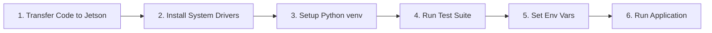

# NVIDIA Jetson Orin Nano Deployment & Execution Guide

This guide provides the complete step-by-step instructions to transfer, configure, test, and run the robot companion runtime on an **NVIDIA Jetson Orin Nano**.

---

## 1. Hardware & Software Prerequisites

### Hardware
- **NVIDIA Jetson Orin Nano** Developer Kit
- **CSI Camera** (e.g. Raspberry Pi Camera Module v2 / v3 or IMX477) connected to the Jetson CSI ribbon port
- **USB Microphone & Speaker** (or USB Audio DAC / headset)
- Network connectivity (Wi-Fi or Ethernet)

### Software
- **NVIDIA JetPack** 5.1+ or 6.x (Ubuntu 20.04 or 22.04 LTS)
- **Python 3.10+**

---

## 2. Step-by-Step Deployment Flow



### Step 1: Transfer Code to the Jetson

From your development workstation terminal, copy the workspace over SSH:

```bash
# Replace 'jetson' and '<jetson-ip>' with your Jetson username and IP address
rsync -avz --exclude '.git' --exclude '__pycache__' --exclude 'venv' --exclude '.pytest_cache' \
  "./" jetson@<jetson-ip>:~/bear-backend-new/
```

*Or clone directly from your git repository on the Jetson:*
```bash
ssh jetson@<jetson-ip>
git clone <your-repository-url> ~/bear-backend-new
cd ~/bear-backend-new
```

---

### Step 2: Install System Packages & Hardware Drivers

On your Jetson, install the system-level libraries for audio capture/playback (`portaudio`) and CSI camera support (`libcamera`/`picamera2`):

```bash
cd ~/bear-backend-new

# Update package lists
sudo apt update

# Install audio drivers and camera support
sudo apt install -y python3-pip python3-venv libportaudio2 portaudio19-dev python3-picamera2
```

---

### Step 3: Set Up Python Environment

Create a virtual environment with `--system-site-packages` enabled so Python can access JetPack's pre-installed hardware-accelerated libraries:

```bash
# 1. Create virtual environment
python3 -m venv --system-site-packages venv

# 2. Activate virtual environment
source venv/bin/activate

# 3. Upgrade pip and install package requirements
pip install --upgrade pip
pip install -r requirements.txt
pip install sounddevice
```

---

### Step 4: Run the Test Suite

Verify that all modules, models, perception engines, and hardware fallbacks are functioning correctly:

```bash
pytest -v
```

#### Expected Output
```text
============================= test session starts ==============================
platform linux -- Python 3.10.x, pytest-9.1.1, pluggy-1.6.0
rootdir: /home/jetson/bear-backend-new
configfile: pyproject.toml
testpaths: tests
collected 34 items

tests/test_application.py::test_build_application_with_env PASSED        [  2%]
tests/test_application.py::test_companion_application_end_to_end PASSED  [  5%]
tests/test_dialogue.py::test_cloud_llm_client_success PASSED             [  8%]
tests/test_dialogue.py::test_cloud_llm_client_failure PASSED             [ 11%]
tests/test_dialogue.py::test_translator_same_language PASSED             [ 14%]
tests/test_dialogue.py::test_translator_pipeline_missing PASSED          [ 17%]
tests/test_dialogue.py::test_translator_with_pipeline PASSED             [ 20%]
tests/test_dialogue.py::test_tts_engine_empty_text PASSED                [ 23%]
tests/test_dialogue.py::test_tts_engine_fallback_synthesis PASSED        [ 26%]
tests/test_dialogue.py::test_tts_engine_custom_backend PASSED            [ 29%]
tests/test_hardware.py::test_camera_stream_invalid_fps PASSED            [ 32%]
tests/test_hardware.py::test_camera_stream_lifecycle PASSED              [ 35%]
tests/test_hardware.py::test_camera_stream_drop_old_frames PASSED        [ 38%]
tests/test_hardware.py::test_audio_stream_energy_vad PASSED              [ 41%]
tests/test_hardware.py::test_audio_stream_barge_in_onset PASSED          [ 44%]
tests/test_hardware.py::test_audio_output_playback_and_interruption PASSED [ 47%]
tests/test_models.py::test_language_enum_values PASSED                   [ 50%]
tests/test_models.py::test_emotion_enum_values PASSED                    [ 52%]
tests/test_models.py::test_emotion_posteriors_normalization PASSED       [ 55%]
tests/test_models.py::test_emotion_posteriors_highest_label PASSED       [ 58%]
tests/test_models.py::test_emotion_posteriors_empty_validation PASSED    [ 61%]
tests/test_models.py::test_emotion_posteriors_negative_probability PASSED [ 64%]
tests/test_models.py::test_emotion_posteriors_zero_sum PASSED            [ 67%]
tests/test_models.py::test_speech_utterance_defaults PASSED              [ 70%]
tests/test_models.py::test_video_frame_defaults PASSED                   [ 73%]
tests/test_perception.py::test_facial_emotion_default_neutral PASSED     [ 76%]
tests/test_perception.py::test_facial_emotion_mock_prediction PASSED     [ 79%]
tests/test_perception.py::test_speech_emotion_default_neutral PASSED     [ 82%]
tests/test_perception.py::test_speech_emotion_onnx_style_run PASSED      [ 85%]
tests/test_perception.py::test_speech_emotion_callable PASSED            [ 88%]
tests/test_perception.py::test_late_fusion_weights PASSED                [ 91%]
tests/test_perception.py::test_speech_recognition_fallback PASSED        [ 94%]
tests/test_perception.py::test_speech_recognition_custom_callable PASSED [ 97%]
tests/test_perception.py::test_speech_recognition_language_normalization PASSED [100%]

============================== 34 passed in 0.54s ==============================
```

---

### Step 5: Configure Environment Variables

Set your Cloud LLM endpoint, API key, and optional remote TTS endpoint:

```bash
# 1. Cloud LLM endpoint (Gemini format)
export ROBOT_LLM_ENDPOINT="https://generativelanguage.googleapis.com/v1beta/models/gemini-1.5-flash:generateContent"
export ROBOT_LLM_API_KEY="YOUR_GEMINI_API_KEY_HERE"

# 2. (Optional) Remote WebSocket TTS endpoint (if using external Orpheus server)
# export ROBOT_TTS_WS_URL="wss://sia-nus-orpheus.karyolymphkinetograph.uk/ws"

# 3. Log level verbosity (INFO or DEBUG)
export LOG_LEVEL="INFO"
```

---

### Step 6: Launch the Application

Run the companion runtime with `PYTHONPATH` pointing to `src`:

```bash
PYTHONPATH=src python3 -m robot_companion.main
```

---

## 3. Expected Terminal Outputs & Lifecycle

### A. Initialization
```text
INFO:robot_companion.main:Starting CompanionApplication...
INFO:robot_companion.hardware.camera_stream:CSI camera stream started (1280x720 @ 15fps)
INFO:robot_companion.hardware.audio_stream:USB microphone stream started (16000Hz, blocksize=512)
```

### B. Live Interaction (User speaks to the robot)
```text
INFO:robot_companion.hardware.audio_stream:VAD speech segment detected (duration: 2.1s)
INFO:robot_companion.perception.facial_emotion:Visual emotion detected: happy (p=0.88)
INFO:robot_companion.perception.speech_emotion:Vocal emotion detected: happy (p=0.74)
INFO:robot_companion.perception.late_fusion:Fused emotion: happy (audio_weight=0.55, visual_weight=0.45)
INFO:robot_companion.perception.speech_recognition:Transcription: "Good morning! How are you doing today?" [lang: en]
INFO:robot_companion.dialogue.cloud_llm:Sending request to Gemini with emotion_context="happy", language="en"
INFO:robot_companion.main:dialogue response ready: "Good morning! It's so wonderful to see you in such bright spirits today!"
INFO:robot_companion.dialogue.tts:Synthesizing response (sample_rate: 16000)
INFO:robot_companion.hardware.audio_output:Streaming playback to speaker...
```

### C. Barge-in Interruption
If the user starts talking while the robot is speaking:
```text
INFO:robot_companion.hardware.audio_stream:Speech onset detected during active playback
INFO:robot_companion.hardware.audio_output:barge-in triggered: interrupting active audio playback
INFO:robot_companion.hardware.audio_stream:Capturing new user utterance...
```

### D. Clean Termination
Press `Ctrl+C` in the terminal:
```text
^C
INFO:robot_companion.main:KeyboardInterrupt received: shutting down application cleanly...
INFO:robot_companion.hardware.camera_stream:CSI camera stopped.
INFO:robot_companion.hardware.audio_stream:Microphone audio capture stopped.
INFO:robot_companion.hardware.audio_output:Audio output stopped.
```

---

## 4. Troubleshooting & Common Jetson Issues

| Problem | Cause | Solution |
| :--- | :--- | :--- |
| `Picamera2 is unavailable; camera stream will remain idle` | Missing libcamera or system site-packages | Ensure `python3-picamera2` is installed via `apt` and venv was created with `--system-site-packages`. Test with `python3 -c "import picamera2"`. |
| `USB microphone read failed` or audio device error | Audio device permission or missing ALSA driver | Run `python3 -m sounddevice` to list available device IDs. Add your user to the audio group: `sudo usermod -aG audio $USER` and re-login. |
| `cloud dialogue request failed` | Invalid API key or endpoint | Verify `ROBOT_LLM_API_KEY` is set and valid. Test network access with `curl -I $ROBOT_LLM_ENDPOINT`. |
| Playback has crackles or buffer underflow | Small audio buffer size under high CPU load | Increase `chunk_size` in [`AudioOutput`](src/robot_companion/hardware/audio_output.py) (e.g. from 1024 to 2048). |

